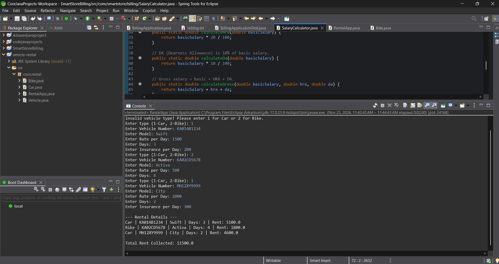

# Vehicle Rental – Lab Assignment

Java console app demonstrating **Inheritance**, **Polymorphism**, and **Scanner**.

| Class | Role |
|---|---|
| `Vehicle` | Base class – `calculateRent()` = ratePerDay × days |
| `Car` | Extends Vehicle – adds insurance per day |
| `Bike` | Extends Vehicle – 10% discount |
| `RentalApp` | Reads input, stores vehicles in `List<Vehicle>`, runtime polymorphism |

## Run

~~~bash
javac -d out src/com/rental/*.java
java -cp out com.rental.RentalApp
~~~

## Output

