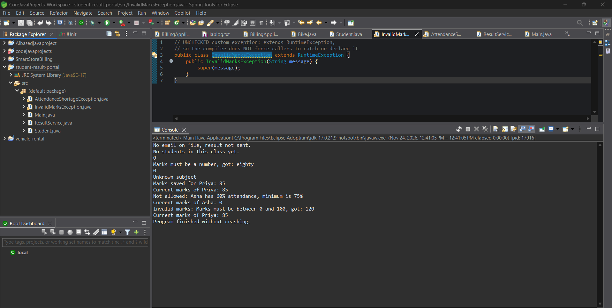

# Student Result Portal – Exception Handling Lab

Fixes five common Java exceptions and adds two custom exceptions.

| Task | Exception | Fix |
|---|---|---|
| 1 | NullPointerException | Prevented with `if (email == null)` |
| 2 | ArithmeticException | try / catch, return 0 |
| 3 | NumberFormatException | try / catch, return 0 |
| 4 | ArrayIndexOutOfBoundsException | try / catch, "Unknown subject" |
| 5–6 | InvalidMarksException | Custom **unchecked** (extends RuntimeException) |
| 7 | AttendanceShortageException | Custom **checked** (extends Exception) |
| 8 | — | try / catch / finally in `Main.saveMarks` |

## Run

~~~bash
javac -d out src/*.java
java -cp out Main
~~~

## Output

